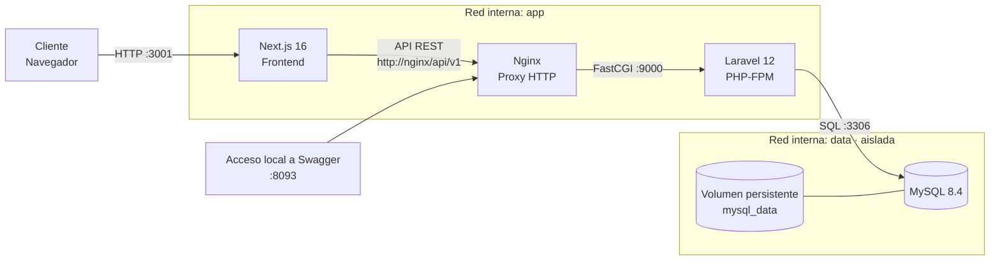
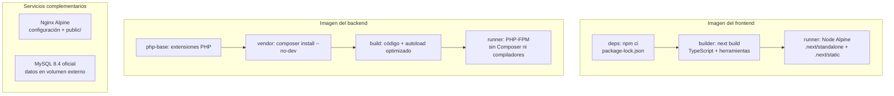

# KODIGO Store · Ecosistema Docker con imágenes multi-stage

**Un proyecto de e-commerce completo, reproducible y aislado:** Next.js 16 (frontend), Laravel 12 + PHP-FPM (API), Nginx (servidor HTTP) y MySQL 8.4 (persistencia).

Esta entrega toma como punto de partida dos aplicaciones desarrolladas previamente en KODIGO y optimiza su ejecución en contenedores. El objetivo es **separar compilación y ejecución**, mejorar el uso de caché, reducir dependencias y ejecutar todo con Docker Compose. **No reutiliza la base de datos ni los secretos de las aplicaciones originales.**

## 1. ¿Qué hace cada contenedor?

| Contenedor | Imagen / tecnología | Función | Acceso |
|---|---|---|---|
| `frontend` | Next.js 16 + Node.js 22 Alpine | Interfaz, catálogo, carrito, autenticación y órdenes | `http://localhost:3001` |
| `nginx` | Nginx Alpine | Recibe solicitudes HTTP y las envía a Laravel/PHP-FPM | `http://127.0.0.1:8093` |
| `backend` | Laravel 12 + PHP 8.4-FPM Alpine | REST API, JWT, lógica de pedidos y Stripe | Solo red interna, puerto 9000 |
| `db` | MySQL 8.4 oficial | Guarda productos, clientes, pedidos y pagos | Solo red interna, puerto 3306 |

**¿Por qué cuatro contenedores si el enunciado menciona tres servicios?** Porque la API necesita dos procesos con responsabilidades distintas: **PHP-FPM ejecuta Laravel** y **Nginx recibe HTTP**. Juntos constituyen el servicio funcional de backend. La arquitectura sigue ofreciendo tres capas de negocio: frontend, backend y base de datos.

### Diagrama A — Recorrido de una solicitud



**Lectura sencilla:** un cliente abre Next.js. Next.js solicita productos a Nginx por la red privada. Nginx entrega la petición a PHP-FPM, Laravel consulta MySQL y responde. **La base de datos no publica ningún puerto hacia la computadora o Internet.** Nginx también se expone localmente para pruebas y Swagger.

### Diagrama B — Construcción multi-stage



**Idea central:** los compiladores y herramientas usadas para construir la aplicación **no se trasladan a las imágenes finales**. MySQL utiliza su imagen oficial: no tiene código de aplicación que requiera un build multi-stage.

## 2. Requisitos

- Docker Engine o Docker Desktop con Docker Compose.
- Git y Bash para clonar el repositorio.
- `openssl` para generar secretos aleatorios locales.
- Puertos **3001** y **8093** disponibles en la computadora.
- Conexión a Internet para descargar imágenes y dependencias en la primera construcción.

No es necesario instalar PHP, Composer, Node.js o MySQL directamente en el sistema: se ejecutan en contenedores.

## 3. Instalación y ejecución desde GitHub

El repositorio **ya incluye el código fuente** en `frontend/` y `backend/`. **No ejecutes el script de importación al clonar el repositorio final**: solo se utilizó durante la preparación inicial del proyecto.

**Paso 1 — Clonar y configurar:**

```bash
git clone https://github.com/KarenSSanchezP/kodigo-ecommerce-docker-multistage.git
cd kodigo-ecommerce-docker-multistage
bash scripts/generar-entorno.sh
```

El script crea un archivo `.env` privado con contraseñas aleatorias para MySQL y claves para Laravel/JWT. Si ya existe, lo conserva. **Nunca publiques ni compartas el contenido de `.env`.** Puedes revisar los nombres de variables esperados en `.env.example`.

**Paso 2 — Construir las imágenes e iniciar los servicios:**

```bash
docker compose config --quiet
docker compose up -d --build
docker compose ps
```

El primer comando valida Compose, el segundo construye las imágenes e inicia los servicios en segundo plano, y el tercero muestra su estado. Docker Compose espera a que MySQL y Nginx superen sus comprobaciones de salud antes de iniciar sus dependientes.

**Paso 3 — Preparar la base de datos (solo la primera vez):**

```bash
docker compose exec -T backend php artisan migrate --force
docker compose exec -T backend php artisan db:seed --force
docker compose exec -T backend php artisan l5-swagger:generate
```

La migración crea las tablas y el seeder carga cinco productos de ejemplo. El volumen MySQL pertenece a **este** proyecto y es independiente de las aplicaciones originales. No repitas la inicialización para cada arranque.

**Paso 4 — Probar los servicios:**

| Componente | Dirección |
|---|---|
| Tienda Next.js | http://localhost:3001 |
| Catálogo REST | http://127.0.0.1:8093/api/v1/products |
| Swagger UI | http://127.0.0.1:8093/api/documentation |
| Salud de Laravel | http://127.0.0.1:8093/up |

```bash
curl -f http://127.0.0.1:8093/up
curl -f http://127.0.0.1:8093/api/v1/products
curl -f http://127.0.0.1:3001/
```

La comunicación interna usa `http://nginx/api/v1` para que Next.js encuentre la API mediante el nombre del servicio Docker; no depende de los puertos del host. Los catálogos ejecutan la consulta durante la petición HTTP usando `await connection()` dentro de `<Suspense>`, evitando que `next build` necesite una API activa.

**Paso 5 — Detener y volver a levantar sin borrar la base de datos:**

```bash
docker compose down
docker compose up -d --wait
```

`down` elimina los contenedores y redes del proyecto, **pero conserva el volumen MySQL**. No utilices `down -v`, ya que elimina los datos persistidos.

> **Nota sobre Stripe:** el modo de pago requiere credenciales de un sandbox activo y el reenvío seguro de eventos por webhook. Es opcional en esta evaluación, que se centra en contenerización, persistencia y optimización de capas.

## 4. Estructura del repositorio

```text
kodigo-ecommerce-docker-multistage/
├── frontend/                     # Código Next.js 16 importado
│   ├── Dockerfile                # deps → builder → runner
│   ├── .dockerignore
│   └── next.config.ts            # output: standalone
├── backend/                      # Código Laravel 12 importado
│   ├── Dockerfile                # php-base → vendor → build → runner
│   ├── .dockerignore
│   └── docker/nginx/
│       ├── Dockerfile            # imagen Nginx
│       └── production.conf
├── db/
│   └── Dockerfile                # imagen oficial MySQL 8.4
├── docker/                       # fuentes de configuración del kit
├── scripts/
│   ├── importar-codigo.sh
│   └── generar-entorno.sh
├── docs/
│   ├── EVIDENCIAS.md
│   └── VALIDACION.md
├── docker-compose.yml
├── .env.example
├── .gitignore
└── README.md
```

## 5. Justificación técnica por imagen

### Frontend (Node 22 Alpine, tres etapas)

1. **`deps`:** `COPY package.json package-lock.json` antes del resto. Al editar componentes, Docker conserva la capa de `npm ci` si el lockfile no cambia. La caché de npm acelera recompilaciones.
2. **`builder`:** ejecuta `next build` con TypeScript y dependencias de desarrollo.
3. **`runner`:** solo copia `.next/standalone`, `.next/static` y `public`. Arranca con `node server.js` y usuario sin privilegios (`node`). No incluye la herramienta de compilación, la carpeta fuente completa ni `node_modules` de desarrollo.

¿Por qué `node server.js` en lugar de `next start`? El servidor autónomo generado por Next.js es la **alternativa oficial más compacta** para contenedores. Cumple el mismo objetivo de ejecutar el build de producción, pero evita transportar todo el árbol de dependencias requerido por `next start`. Véase [Next.js: standalone output](https://nextjs.org/docs/app/api-reference/config/next-config-js/output) y [Docker: guía de Next.js](https://docs.docker.com/guides/nextjs/).

### Backend (PHP 8.4 Alpine + Composer, cuatro etapas)

1. **`php-base`:** instala solo bibliotecas y extensiones necesarias: `pdo_mysql`, `mbstring`, `bcmath`, `intl`, `zip`. `openssl`, `tokenizer`, `xml`, `ctype` y `json` proceden de la imagen PHP oficial.
2. **`vendor`:** instala dependencias con Composer y `--no-dev`, en una capa independiente de cambios del código de Laravel.
3. **`build`:** copia el código y el directorio `vendor/`, optimiza autoload y descubre proveedores.
4. **`runner`:** copia archivos desde la etapa de build, sin Composer, compiladores, Git ni paquetes de desarrollo. Ejecuta **PHP-FPM como `www-data`**, no como root.

Se conservan únicamente los directorios de aplicación necesarios y se otorgan permisos de escritura a `storage/` y `bootstrap/cache/`. No se incorpora `.env` en la imagen, y el servidor web Nginx se construye por separado.

### Nginx (Alpine)

Actúa como servidor HTTP de la API. Copia únicamente `public/` y su configuración de FastCGI; redirige las solicitudes PHP al servicio `backend:9000`. No publica el puerto PHP-FPM. La imagen ligera se puede actualizar o ajustar de forma independiente.

### MySQL 8.4 (imagen oficial)

No requiere compilar código ni instalar dependencias. El Dockerfile parte de la imagen oficial. Conserva los datos en el volumen **`kodigo-ecommerce-multistage_mysql_data`**. Por claridad, MySQL está en una red interna llamada `data` que no permite conexiones entrantes desde el exterior.

## 6. Caché de capas y medición de imágenes

Los dos Dockerfiles colocan primero los archivos de dependencias (`package-lock.json`, `composer.lock`), y después el código. Así una modificación CSS o PHP normalmente **no reinstala las dependencias**. BuildKit incluye cachés reutilizables para npm y Composer.

Para repetir las mediciones de caché y tamaño:

```bash
# Primera compilación y su duración (si ya están creadas las imágenes, anota esa condición)
time docker compose --progress plain build

# Repetir sin modificar lockfiles, para observar caché
time docker compose --progress plain build

# Imágenes finales y tamaños medidos de verdad
docker image ls --format 'table {{.Repository}}\t{{.Tag}}\t{{.Size}}'

docker compose ps
```

Comparar el tamaño con las imágenes iniciales del bootcamp es **opcional** y solo debe hacerse cuando se hayan medido de forma equivalente (misma arquitectura de CPU y método de medida). Las cifras reales registradas en el equipo de desarrollo se detallan en `docs/VALIDACION.md`; otras computadoras pueden producir resultados distintos.

## 7. Seguridad y límites del entorno

- `.env` queda ignorado por Git y los `.dockerignore` impiden incorporarlo a imágenes.
- `APP_DEBUG=false` y `APP_ENV=production` para evitar detalles internos en las respuestas.
- Frontend y PHP corren como usuarios sin privilegios; MySQL no publica puerto al host.
- Solo se exponen los puertos locales `127.0.0.1:3001` y `127.0.0.1:8093`, para evitar conflictos con otras tareas y limitar el acceso.
- El código fuente del frontend y backend está incluido en este repositorio, a partir de copias de los proyectos originales, que no se modifican.
- **Este Compose es un laboratorio de producción optimizada, no una solución pública de producción sin HTTPS.** Para Internet se requieren TLS, dominio, rotación de secretos, backups, métricas, actualizaciones de dependencias y un gestor de secretos. Las variables de entorno de Compose pueden inspeccionarse por administradores del host.
- Stripe de prueba debe configurarse con un sandbox activo. No subas claves secretas ni tokens.

## 8. Solución de problemas

| Síntoma | Qué revisar |
|---|---|
| El frontend muestra error de conexión | `docker compose ps`, `docker compose logs --tail=70 nginx backend`, `API_BASE_URL=http://nginx/api/v1` |
| HTTP 500 en Laravel | `docker compose logs --tail=100 backend` y permisos de `storage/` |
| Swagger no carga los endpoints | `docker compose exec -T backend php artisan l5-swagger:generate` |
| Registro/login no funciona | Validar `APP_KEY`, `JWT_SECRET`, cookies y que `db` esté saludable |
| Puerto 3001/8093 ocupado | Detener proceso anterior o modificar puertos de host en Compose |
| Compilación PHP o Node lenta | Primera build descarga dependencias; repetir con caché y revisar RAM de Docker |
| La API antigua sigue activa | Es esperado: **esta entrega usa puertos y volumen diferentes** |

Comandos de soporte:

```bash
docker compose logs --tail=100 backend
docker compose logs --tail=100 frontend
docker compose logs --tail=100 nginx
docker compose ps
docker compose down
```

**Advertencia:** evita `docker compose down -v` porque borra el volumen de datos de este proyecto. Evita también `migrate:fresh` si ya existen pedidos.

## 9. Entrega y evidencias

Adjunta a KODIGO la URL pública de **este repositorio nuevo**, no solamente los dos repositorios de origen. Las indicaciones de capturas, pruebas y mediciones se encuentran en [`docs/EVIDENCIAS.md`](docs/EVIDENCIAS.md).

**Repositorios de origen:** [Frontend](https://github.com/KarenSSanchezP/frontend-ecommerce-kodigo) · [Backend](https://github.com/KarenSSanchezP/api-ecommerce-kodigo).

**Validación técnica:** los resultados observados y los límites de interpretación de las mediciones están documentados en [`docs/VALIDACION.md`](docs/VALIDACION.md).
